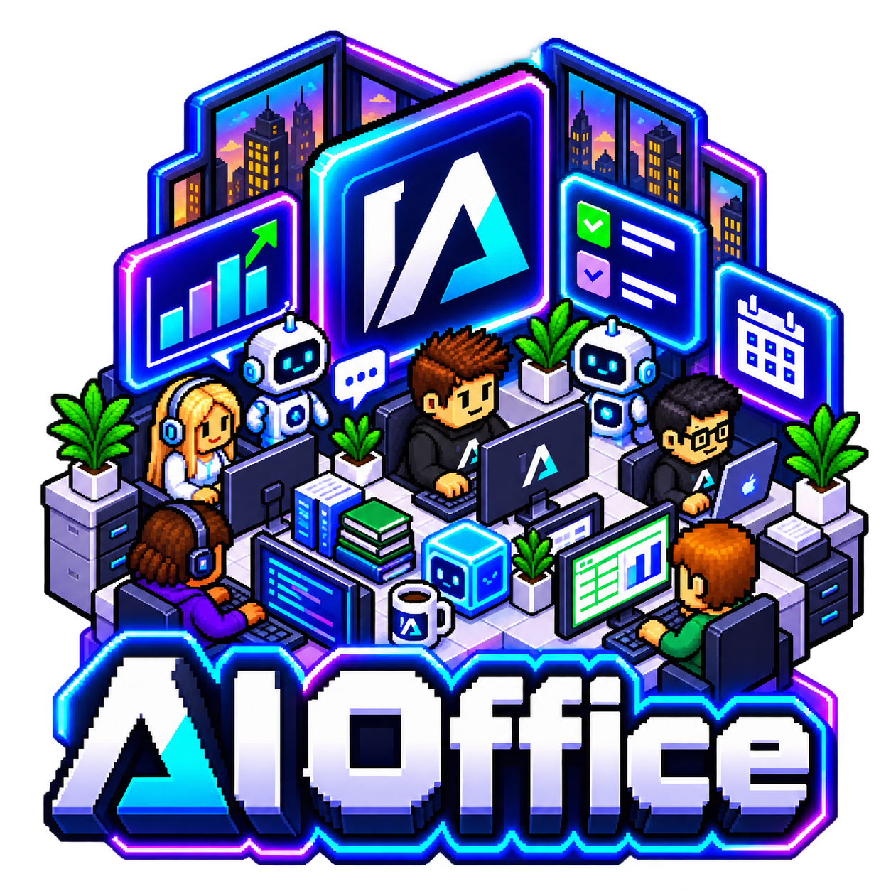
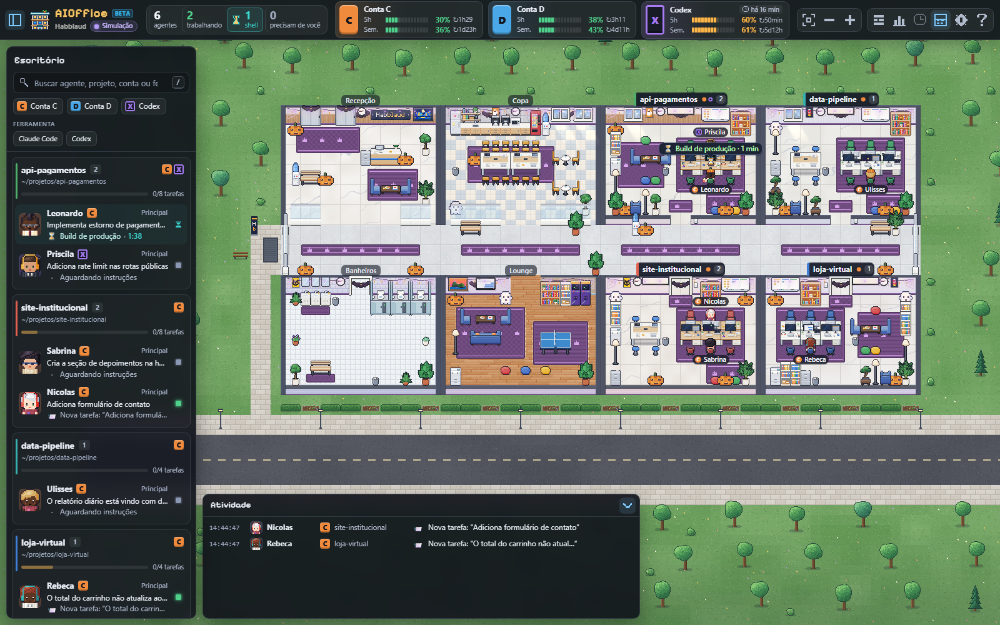
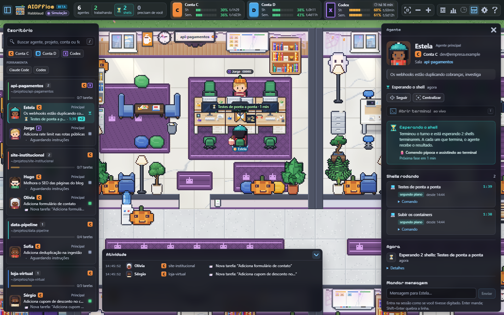
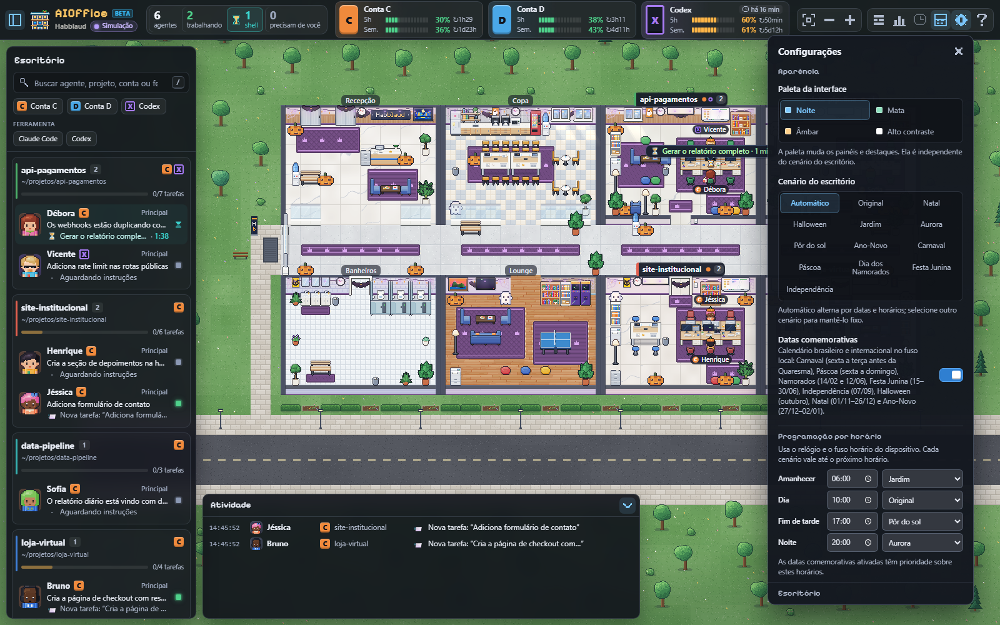

<p align="center">
  
</p>

# AIOffice

<p align="center"><strong>Seu escritório virtual para Claude Code, Codex e oh-my-pi.</strong><br />Projetos, agentes, tarefas e atividade recente em uma interface pixel art, com governança e segurança no mesmo monorepo.</p>

<p align="center">
  
  
  
</p>

<p align="center">
  <a href="https://github.com/IAPro-Community/AIOffice/releases/latest">📦 Releases</a> ·
  <a href="CHANGELOG.md">📝 Changelog</a> ·
  <a href="DEV/DESKTOP.md">🖥️ Desktop e distribuição</a> ·
  <a href="apps/office-web/README.pt-BR.md">🎮 Guia do escritório</a>
</p>



> Todas as capturas deste README foram feitas com o simulador local do aplicativo. Projetos, agentes, tarefas e contas são fictícios.

## Downloads

Estes links sempre apontam para a **última release publicada**. Uma mudança no código só aparece aqui depois que os builds de todos os sistemas passam e a release é publicada. Consulte também a página de [releases](https://github.com/IAPro-Community/AIOffice/releases/latest) para notas, checksums e arquivos da versão.

| Sistema | Pacote | Download |
|---|---|---|
| Windows x64 | Instalador `.exe` | [Baixar AIOffice-Setup.exe](https://github.com/IAPro-Community/AIOffice/releases/latest/download/AIOffice-Setup.exe) |
| macOS Apple silicon (M1/M2/M3/M4) | Temporariamente indisponível; build assinado pendente | — |
| macOS Intel | Temporariamente indisponível; build assinado pendente | — |
| Linux x64 | AppImage portátil | [Baixar AIOffice-Setup-Linux-x64.AppImage](https://github.com/IAPro-Community/AIOffice/releases/latest/download/AIOffice-Setup-Linux-x64.AppImage) |
| Linux x64 | Pacote Debian/Ubuntu `.deb` | [Baixar AIOffice-Setup-Linux-x64.deb](https://github.com/IAPro-Community/AIOffice/releases/latest/download/AIOffice-Setup-Linux-x64.deb) |

Os arquivos macOS da release `v2.4.3` foram publicados sem assinatura Developer ID nem notarização. Eles podem ser rejeitados pelo Gatekeeper com a mensagem de app danificado ou modificado; **não tente contornar esse bloqueio**. O download macOS ficará indisponível aqui até uma nova compilação assinada e notarizada passar pela validação de assinatura, Gatekeeper e ticket da Apple. O atualizador automático do macOS só é habilitado em builds assinadas e notarizadas. No Linux, a atualização em segundo plano é compatível com o AppImage; o `.deb` é atualizado pelo gerenciador de pacotes. No Windows, o app consulta releases em background, sem recarregar a página, e valida o instalador pelo SHA-256 publicado pelo GitHub antes de pedir confirmação para instalá-lo. O instalador Windows ainda pode exibir SmartScreen enquanto não houver certificado Authenticode.

O desktop inclui o runtime Node e inicia o servidor e a interface local. Em **Sobre → Ferramentas de IA**, você pode instalar ou atualizar Codex, Claude Code e OMP dentro do perfil privado do AIOffice; isso não muda o `PATH` global. A autenticação abre o CLI oficial em um terminal interativo, e você entra na conta diretamente com o fornecedor. O AIOffice não recebe nem armazena essas credenciais. Uma confirmação permite reiniciar o aplicativo para ativar um CLI recém-instalado. Ao abrir o desktop, o AIOffice instala ou atualiza automaticamente suas pontes de mensagens do Claude Code e OMP; Codex usa a CLI instalada ou uma cópia oficial já encontrada. Não é preciso manter comandos `npm run` abertos no desktop. Sessões Claude/OMP já abertas podem precisar ser recarregadas ou reabertas. No Docker, o envio ao Codex ainda exige o auxiliar executado no host.

## O que você encontra no AIOffice

- **Escritório visual:** salas por projeto, agentes em pixel art, subagentes, tarefas, esperas por shell e feed de atividade.
- **Acompanhamento de sessões:** lê sessões locais de Claude Code, Codex e OMP; integrações e capacidades variam por ferramenta.
- **Controles pelo escritório:** acompanha pedidos de permissão e permite enviar mensagens conforme a bridge de cada provedor esteja instalada e ativa.
- **Orquestrador-Maestro:** roteamento de intenções, limites e registro de decisões operacionais em `DEV/`.
- **OpenOrq:** mediação de escritas, controle de subprocessos e armazenamento local de credenciais BYOK.
- **Aplicativo desktop:** janela nativa Electron com servidor local integrado, diagnóstico e fluxo de atualização próprio.



### Configurações e temas

Escolha paleta, cenário, calendário de datas comemorativas, horários e idioma.



## Começar

### Usar o aplicativo desktop

Baixe o pacote correspondente ao seu sistema na tabela acima e abra **AIOffice**. O aplicativo sobe a interface local em `http://127.0.0.1:4747` automaticamente. O instalador inclui o runtime necessário; não precisa instalar Node.js para executar o desktop. No macOS, escolha `arm64` para Apple silicon e `x64` para Intel; abra o `.dmg` e arraste o app para **Aplicativos**. No Linux, marque o AppImage como executável (`chmod +x AIOffice-Setup-Linux-x64.AppImage`) e abra-o; o `.deb` pode ser instalado por um gerenciador de pacotes Debian/Ubuntu.

### Executar pelo código-fonte

**Requisitos:** Node.js `>=22.12` e npm `>=10`.

```bash
git clone https://github.com/IAPro-Community/AIOffice.git
cd AIOffice
npm run setup
npm run start:office
```

Abra [http://localhost:4747](http://localhost:4747). Para subir pelo Docker, use `npm --prefix apps/office-web run docker:up`.

O setup instala dependências, prepara os pacotes e verifica a camada do Orquestrador-Maestro. Em **Configurações → Orquestrador-Maestro**, a busca por atualização acontece em segundo plano; aplicar uma atualização exige clicar no botão. O atualizador **Sobre** acompanha as releases do AIOffice.

Para preparar uma tarefa no terminal, o padrão mostra apenas o roteamento:

```bash
npm start -- "Extrair design tokens e cores do aplicativo"
```

O executor de fallback do Maestro exige a opção explícita `--maestro-fallback`; esse fluxo é demonstrativo e aprova automaticamente escritas de artefatos no workspace.

## Acesso pelo celular

O painel local pode criar um Cloudflare Quick Tunnel a pedido do usuário em **Configurações → Acesso pelo celular**. Instale [`cloudflared`](https://developers.cloudflare.com/cloudflare-one/connections/connect-networks/downloads/) e deixe-o disponível no `PATH` do AIOffice. O túnel não inicia automaticamente. Depois de iniciar, abra no telefone o link HTTPS ou o QR atual e digite o código de seis caracteres gerado no painel. O código vale por cinco minutos e um único login; não é incluído no link nem no QR.

O acesso passa pela infraestrutura Cloudflare e fica disponível pela internet enquanto o computador, o AIOffice e o túnel estiverem ativos. Compartilhe link e código com cuidado. Se o Chrome exibir um aviso de site perigoso, não prossiga nem informe o código. A sessão remota tem controles por dispositivo e expira em até 12 horas; parar ou reiniciar o servidor encerra as sessões.

## Compilar e verificar

```bash
npm run desktop:dev
npm run desktop:build
npm run desktop:package:win
npm run desktop:package:mac:x64
npm run desktop:package:mac:arm64
npm run desktop:package:linux
npm run desktop:verify
```

Cada instalador deve ser criado no sistema operacional correspondente. O workflow oficial testa Windows x64, macOS Intel, macOS Apple silicon e Linux x64 em runners nativos; uma etapa final valida os arquivos e manifestos de atualização e só então publica a release. Authenticode e assinatura/notarização Apple são opcionais no workflow, mas sem elas os sistemas podem mostrar avisos e o macOS mantém atualização manual. Consulte [DEV/DESKTOP.md](DEV/DESKTOP.md) para detalhes, requisitos e limites atuais.

## Integrações

| Ferramenta | O que aparece no escritório | Observações |
|---|---|---|
| Claude Code | Sessões, atividade, histórico, uso e recursos de mensagem/permissão | O desktop instala/verifica o plugin e pode instalar/atualizar o CLI oficial. Login feito no terminal do fornecedor. Sessões abertas podem precisar de `/reload-plugins`. |
| Codex CLI / app | Sessões, histórico, atividade, uso e mensagens locais | O desktop pode instalar/atualizar o CLI oficial e usa `codex queue`; aprove os hooks em `/hooks` para eventos e aprovações. No Docker, mantenha `npm run codex:bridge` no host. |
| oh-my-pi (OMP) | Sessões, histórico, atividade e mensagens | O desktop pode instalar/atualizar o CLI oficial e instala/atualiza a extensão do AIOffice; em sessões antigas, feche e abra de novo. `omp:install` continua disponível no modo Node. |
| Google Antigravity | Sessões, atividade e envio de mensagens pela integração local | O desktop instala o hook do AIOffice se encontrar o perfil Gemini; enviar mensagem exige um hook validado e ativo. |

Devin, OpenCode, Freebuf e Gemini CLI não têm integração de sessões e mensagens de ponta a ponta. Uma conexão MCP também não equivale à leitura de uma sessão de CLI.

## Estrutura

```text
apps/
  office-web/       Habblaud: interface React/Vite e servidor HTTP/SSE
  office-desktop/   Shell Electron e ciclo de atualização
  office-cli/       CLI e host de orquestração
packages/
  maestro-contract/ Contratos e roteamento de intenções
  policy-broker/    Mediação de escritas e diffs
  rpc-proxy/        Controle de subprocessos
  credential-store/ Cofre local de credenciais
  runtime/          Adaptadores de runtime e subagentes
DEV/                Contexto, especificações, decisões e verificações
```

O escritório visual é baseado no [Habblaud](https://github.com/marmottajr/habblaud) (MIT). Outros projetos-base e licenças estão documentados em [`apps/office-web/README.md`](apps/office-web/README.md) e nos avisos de terceiros que acompanham o aplicativo.

## Segurança e privacidade

- O servidor local aceita conexões de loopback por padrão; não exponha a porta HTTP diretamente à rede.
- O acesso remoto é opcional e usa um túnel Cloudflare, com autenticação por código temporário de uso único.
- A integração de cada ferramenta lê dados locais conforme suas capacidades; não confunda disponibilidade no `PATH` com conta autenticada.
- Chaves BYOK ficam armazenadas localmente no cofre do AIOffice. O túnel móvel encaminha tráfego pela infraestrutura Cloudflare.

Veja também [`DEV/CONTEXT.md`](DEV/CONTEXT.md), [`DEV/VERIFY.md`](DEV/VERIFY.md) e [`DEV/DESKTOP.md`](DEV/DESKTOP.md).

## Changelog e licença

Veja as notas em [`CHANGELOG.md`](CHANGELOG.md). O projeto é distribuído sob licença [MIT](LICENSE); projetos-base podem manter licenças próprias.
